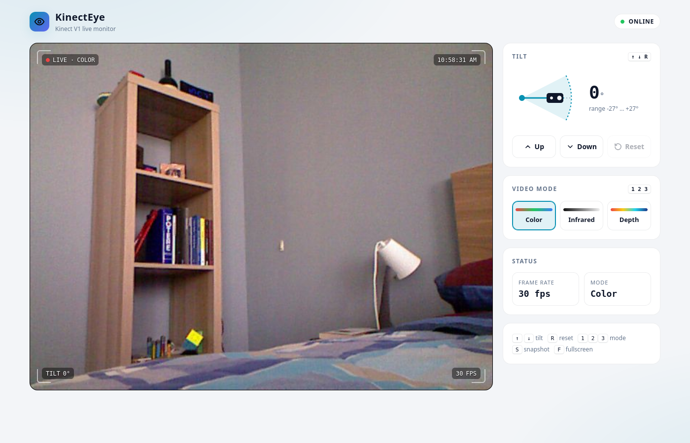
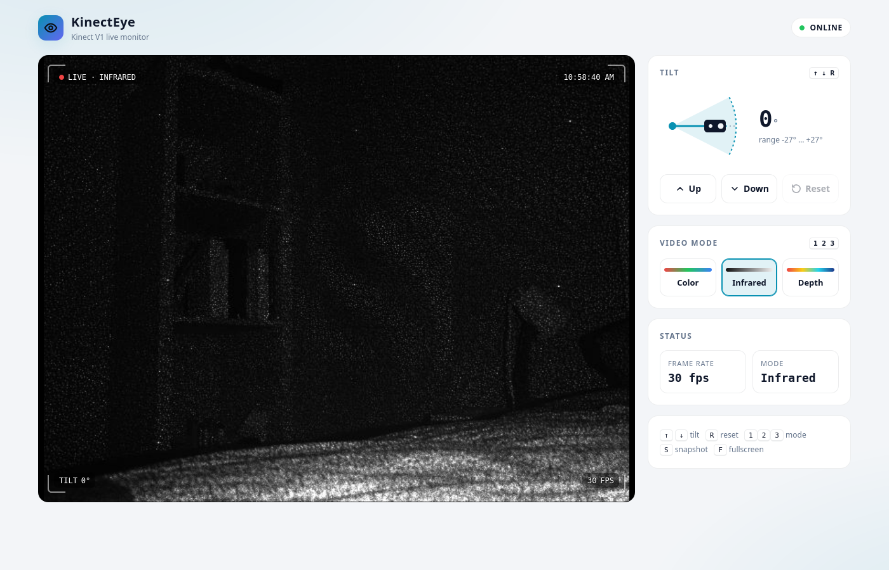
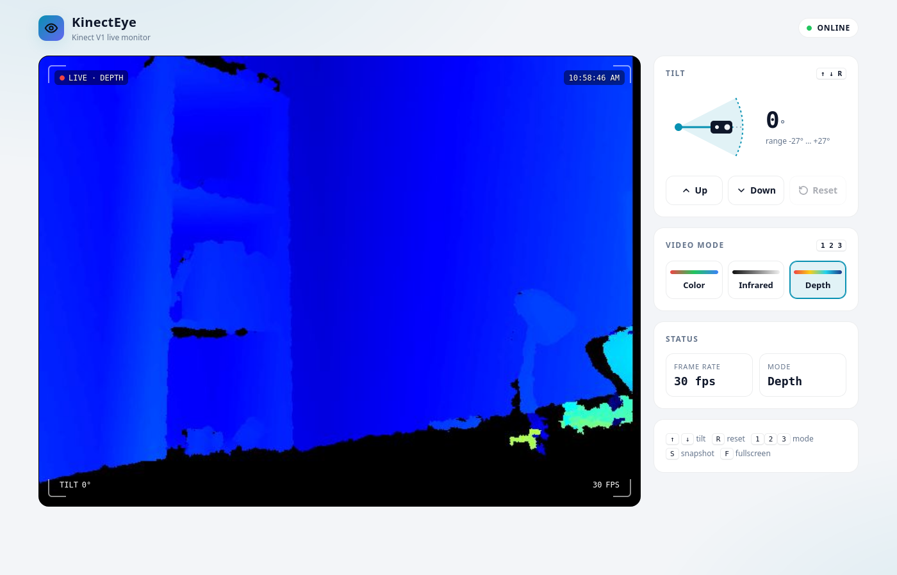
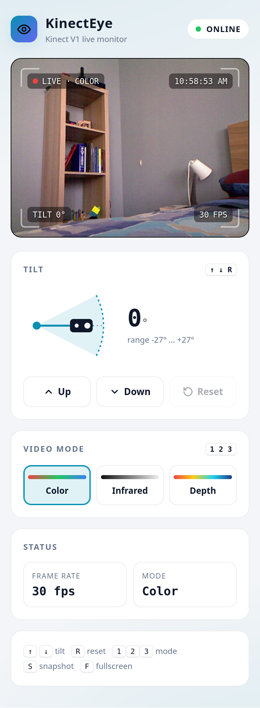

# KinectEye

**KinectEye** turns a **Microsoft Kinect V1** (Xbox 360 Kinect) connected to a Linux computer into a small **surveillance camera you can watch and control from the browser**.

A lightweight Python / Flask server reads the Kinect through the open-source **libfreenect** driver and streams the video in real time to any device on the local network (PC, phone, tablet). From the same web page you can **move the tilt motor** and **switch between color, infrared and depth view**.

---

## Table of contents

1. [Features](#features)
2. [Hardware required](#hardware-required)
3. [Software stack](#software-stack)
4. [How it works](#how-it-works)
5. [Repository structure](#repository-structure)
6. [Installation (step by step)](#installation-step-by-step)
7. [Starting the local stream](#starting-the-local-stream)
8. [Using the web app](#using-the-web-app)
9. [Watching from other devices](#watching-from-other-devices)
10. [HTTP API](#http-api)
11. [Troubleshooting](#troubleshooting)
12. [Screenshots](#screenshots)
13. [Further documentation](#further-documentation)

---

## Features

| Feature | Status |
|---------|--------|
| Real-time MJPEG video streaming in the browser, shared by any number of viewers | ✅ Available |
| Tilt motor control in 5° steps, limited to the hardware range (±27°) | ✅ Available |
| Video modes: **Color (RGB)**, **Infrared** (works in the dark), **Depth** (colored distance map) | ✅ Available |
| HUD overlay on the video: mode, clock, tilt angle, frame rate | ✅ Available |
| Snapshot download (JPEG) and fullscreen view | ✅ Available |
| Keyboard shortcuts, dark / light theme, phone-friendly layout | ✅ Available |
| Automatic reconnection if the Kinect is unplugged and plugged back | ✅ Available |
| Access from outside the local network (internet) | 🚧 Not yet |

---

## Hardware required

| Item | Notes |
|------|-------|
| **Kinect V1** (Xbox 360 model 1414 / 1473) | The Kinect for Xbox One (V2) is **not** supported by libfreenect |
| **Kinect AC adapter with USB connector** | The Xbox 360 Kinect has a proprietary plug: it needs this adapter to get **12 V power** and a standard USB connector. Example on [Amazon](https://www.amazon.it/dp/B0776NDZJ6?ref=ppx_yo2ov_dt_b_fed_asin_title) |
| **Linux computer** | Tested on Ubuntu 24.04 and Lubuntu 24.04 (x86_64). A USB 2.0 port is enough |

> ⚠️ **The power adapter must be plugged into the wall socket.** Without the 12 V supply only the motor is detected by the computer: the camera does not appear and there is no video.

---

## Software stack

| Component | Role |
|-----------|------|
| **Ubuntu / Lubuntu 24.04 LTS** | Operating system |
| **libfreenect 0.5** | Open-source USB driver for the Kinect V1 (camera, depth, motor, LED) |
| **Python 3.12** | Language of the server |
| **freenect** (Python binding) | Calls libfreenect from Python |
| **OpenCV** | Color conversion, depth colormap, JPEG encoding |
| **NumPy** | Frame processing |
| **Flask** | Web server and HTTP API |

---

## How it works

```
 Kinect V1 ──USB──▶ libfreenect ──▶ Kinect thread ──JPEG──▶ Flask ──MJPEG──▶ Browsers
                                        ▲                     │
                                        └── tilt / mode ◀─────┘  (command queue)
```

- **One background thread owns the Kinect.** It opens the device, runs the libfreenect event loop and receives every frame.
- Each frame is converted (RGB → BGR, or depth → colored map) and **encoded to JPEG only once**, then shared by all the connected browsers.
- The web page sends **tilt and mode commands** to the server; Flask puts them in a queue and the Kinect thread executes them. Flask never touches the USB device directly: this avoids the `LIBUSB_ERROR_BUSY` conflicts and crashes of the first versions of the project.
- The video reaches the browser as an **MJPEG stream** (`multipart/x-mixed-replace`): a plain `` tag, no plugins needed.
- If the Kinect is unplugged, the thread keeps retrying every 2 seconds and the page shows **NO SIGNAL** until it comes back.

---

## Repository structure

```
KinectEye/
├── README.md                     ← this file
├── requirements.txt              ← Python dependencies (used by setup/install.sh)
├── setup/
│   ├── setup_instructions.md     ← installation reference
│   ├── basic_commands.md         ← keyboard commands of freenect-glview
│   └── install.sh                ← optional: creates a virtualenv with all Python deps
├── kinect_streaming/
│   ├── app.py                    ← the web server (run this)
│   ├── templates/index.html      ← the web page
│   └── README.md                 ← app options, shortcuts, API
└── docs/screenshots/             ← images used in this README
```

---

## Installation (step by step)

All commands are run in a normal terminal on the computer the Kinect is connected to.

> 💡 Do **not** prefix the commands with `!`. In bash, `!` negates the result of a command, so `! cmd1 && cmd2` silently skips `cmd2`.

### Step 1 — Get the code

```bash
sudo apt update
sudo apt install -y git
cd ~/Desktop
git clone https://github.com/Mic-Hub-ux/KinectEye.git
cd KinectEye
```

### Step 2 — Install the system packages

```bash
sudo apt install -y build-essential cmake git python3-pip python3-dev cython3 \
    python3-opencv python3-numpy python3-flask \
    libusb-1.0-0-dev libfreenect0.5 libfreenect-dev libfreenect-bin
```

- If apt answers **"Unable to locate package"**, enable the extra repositories and retry:
  ```bash
  sudo apt install -y software-properties-common
  sudo add-apt-repository -y universe
  sudo add-apt-repository -y multiverse
  sudo apt update
  ```
- If apt answers **"Could not get lock /var/lib/dpkg/lock-frontend … held by process … (unattended-upgr)"**, Ubuntu is installing its automatic updates in the background: wait a few minutes and retry. Do not delete the lock files.

### Step 3 — Install the Python binding of libfreenect

```bash
pip3 install freenect --break-system-packages
```

`--break-system-packages` is needed because Ubuntu 24.04 protects the system Python. Check that every module loads:

```bash
python3 -c "import freenect, cv2, numpy, flask; print('all OK')"
```

<details>
<summary><b>Alternative: isolated virtual environment</b> (instead of steps 2-3 for the Python part)</summary>

`setup/install.sh` creates a `.venv` folder in the project, installs the packages listed in `requirements.txt` and compiles the freenect binding from the libfreenect sources. The system packages `build-essential git libusb-1.0-0-dev libfreenect-dev` are still required.

```bash
./setup/install.sh
```
With this method, start the server with `.venv/bin/python kinect_streaming/app.py`.
</details>

### Step 4 — Disable the kernel webcam driver (`gspca_kinect`) ⚠️

This is the step that is most often forgotten. Ubuntu includes a kernel driver that takes the Kinect camera as a generic webcam (`/dev/videoX`) as soon as it is plugged in. While it is loaded, libfreenect cannot open the camera and the app fails with:

```
Failed to claim camera interface: LIBUSB_ERROR_BUSY
Segmentation fault (core dumped)
```

Unload it now and blacklist it so it is not loaded again at boot:

```bash
sudo modprobe -r gspca_kinect
echo "blacklist gspca_kinect" | sudo tee /etc/modprobe.d/blacklist-kinect.conf
```

Check: `lsmod | grep gspca_kinect` must print **nothing**.

### Step 5 — Allow access to the Kinect without `sudo`

By default only root can open USB devices. This udev rule gives access to the three Kinect devices (motor, audio, camera):

```bash
sudo tee /etc/udev/rules.d/66-kinect.rules > /dev/null <<'EOF'
SUBSYSTEM=="usb", ATTR{idVendor}=="045e", ATTR{idProduct}=="02b0", MODE="0666"
SUBSYSTEM=="usb", ATTR{idVendor}=="045e", ATTR{idProduct}=="02ad", MODE="0666"
SUBSYSTEM=="usb", ATTR{idVendor}=="045e", ATTR{idProduct}=="02ae", MODE="0666"
EOF
sudo udevadm control --reload-rules && sudo udevadm trigger
```

### Step 6 — Connect the Kinect

1. Plug the **power adapter into the wall socket**.
2. Plug the **USB cable into the computer**. If it was already connected, unplug and replug it so the new rules (steps 4-5) are applied.
3. Check that the computer sees it:
   ```bash
   lsusb | grep -i microsoft
   ```
   You must see **three** lines:
   ```
   ... ID 045e:02b0 Microsoft Corp. Xbox NUI Motor
   ... ID 045e:02ad Microsoft Corp. Xbox NUI Audio
   ... ID 045e:02ae Microsoft Corp. Xbox NUI Camera
   ```
   Only the *Motor* line → the power adapter is not plugged in.

### Step 7 — Test with the native viewer (optional)

```bash
freenect-glview
```

Two windows open (RGB and depth). Press `w` / `x` to move the motor, `s` to reset it, `Esc` to close. Full list of keys → [setup/basic_commands.md](setup/basic_commands.md).

> Close `freenect-glview` before starting the web app: only one program at a time can use the Kinect.

---

## Starting the local stream

From the project folder:

```bash
cd ~/Desktop/KinectEye
python3 kinect_streaming/app.py
```

The server prints the addresses to open:

```
KinectEye running on:
  http://localhost:5000
  http://192.168.1.137:5000  (other devices on the same network)
Kinect opened.
```

Open **http://localhost:5000** in a browser on the same computer. The Kinect LED turns **green** while it is streaming (**red** after the server stops).

To stop the server press **Ctrl+C** in the terminal.

### Options

| Option | Default | Description |
|--------|---------|-------------|
| `--port` | `5000` | HTTP port |
| `--host` | `0.0.0.0` | Address to listen on. `0.0.0.0` = reachable from the network, `127.0.0.1` = this computer only |
| `--quality` | `80` | JPEG quality 1-100. Lower values use less bandwidth (useful on slow Wi-Fi) |

Example: `python3 kinect_streaming/app.py --port 8080 --quality 60`

---

## Using the web app

| Element | What it does |
|---------|--------------|
| **Live video** | The Kinect stream with a HUD showing mode, clock, tilt and FPS. Shows *NO SIGNAL* when the Kinect is not available |
| **Snapshot button** | Downloads the current frame as a JPEG |
| **Fullscreen button** | Shows the video full screen |
| **Tilt gauge** | Shows the current motor angle inside the −27° … +27° range. *Up* / *Down* move it by 5°, *Reset* brings it back to 0° |
| **Mode cards** | **Color** = normal camera · **Infrared** = IR camera, sees in the dark using the Kinect IR projector · **Depth** = distance map (warm colors = near, cold colors = far, black = no reading) |
| **Status** | Connection state, frame rate, current mode and error messages |
| **Theme** | Follows the system dark / light setting |

### Keyboard shortcuts

| Key | Action |
|-----|--------|
| **↑ / ↓** | Tilt up / down by 5° |
| **R** | Reset tilt to 0° |
| **1 / 2 / 3** | Color / Infrared / Depth |
| **S** | Save a snapshot |
| **F** | Fullscreen |

---

## Watching from other devices

Any device connected to the **same network** (same Wi-Fi / router) can open the stream:

1. Find the IP address of the Kinect computer — it is printed when the server starts, or run:
   ```bash
   hostname -I
   ```
   The first address (e.g. `192.168.1.137`) is the one to use. It may change when the computer reconnects to the network.
2. On the phone / other PC open `http://<that IP>:5000`.

If the page does not load, the firewall may be blocking the port. On Ubuntu, if `ufw` is active:

```bash
sudo ufw allow 5000/tcp
```

> 🔒 The server has **no password**: anyone on the same network can watch and move the camera. Do not expose it directly to the internet.

---

## HTTP API

The web page uses a small JSON API that can also be called from scripts.

| Method | Path | Body (JSON) | Description |
|--------|------|-------------|-------------|
| GET | `/video_feed` | — | MJPEG video stream |
| GET | `/api/status` | — | Connection, mode, tilt, limits, fps, last error |
| POST | `/api/tilt` | `{"action": "up" \| "down" \| "reset"}` | Move the motor by one step / reset |
| POST | `/api/mode` | `{"mode": "rgb" \| "ir" \| "depth"}` | Change video mode |

Examples:

```bash
curl http://localhost:5000/api/status
curl -X POST -H "Content-Type: application/json" -d '{"action":"up"}'   http://localhost:5000/api/tilt
curl -X POST -H "Content-Type: application/json" -d '{"mode":"depth"}'  http://localhost:5000/api/mode
```

---

## Troubleshooting

| Problem | Cause / fix |
|---------|-------------|
| `Failed to claim camera interface: LIBUSB_ERROR_BUSY` then `Segmentation fault` | The `gspca_kinect` kernel driver is loaded (→ [step 4](#step-4--disable-the-kernel-webcam-driver-gspca_kinect-️)) or another program is using the Kinect (close `freenect-glview` or other running copies of the app) |
| Page shows **NO SIGNAL** / *Kinect not found* | Kinect not connected or not powered. Run `lsusb \| grep -i microsoft`: you need three lines (→ [step 6](#step-6--connect-the-kinect)) |
| Only `Xbox NUI Motor` appears in `lsusb` | The 12 V power adapter is not plugged into the wall socket |
| Works only with `sudo` | udev rule missing (→ [step 5](#step-5--allow-access-to-the-kinect-without-sudo)) |
| `ModuleNotFoundError: No module named 'freenect'` | Python binding not installed (→ [step 3](#step-3--install-the-python-binding-of-libfreenect)) |
| `Command 'pip3' not found` | `python3-pip` not installed (→ [step 2](#step-2--install-the-system-packages)) |
| `Address already in use` | Another copy of the server is already running: stop it, or use `--port 5001` |
| Other devices cannot open the page | Not on the same network, wrong IP, or firewall (`sudo ufw allow 5000/tcp`) |
| Video is slow / laggy on Wi-Fi | Lower the JPEG quality: `--quality 50` |
| `Invalid magic` / `Lost packets` messages | USB bandwidth problem: use a port directly on the computer (not a hub) and replug the Kinect |

---

## Screenshots

### Color mode


### Infrared mode


### Depth mode


### Phone layout


---

## Further documentation

- Installation reference → [setup/setup_instructions.md](setup/setup_instructions.md)
- `freenect-glview` keyboard commands → [setup/basic_commands.md](setup/basic_commands.md)
- Web app details → [kinect_streaming/README.md](kinect_streaming/README.md)
